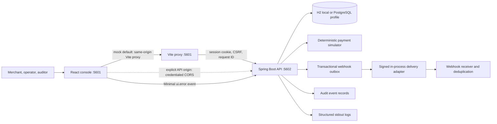
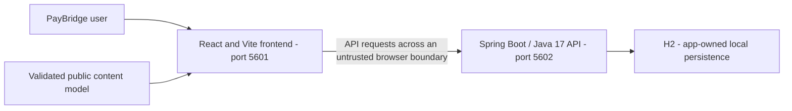
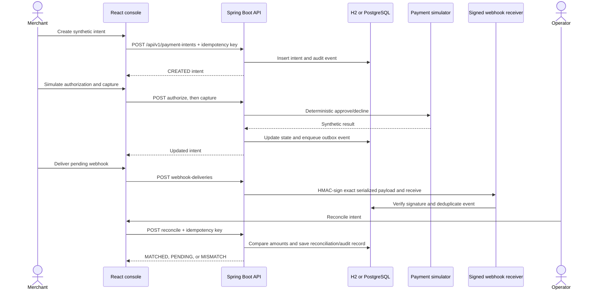
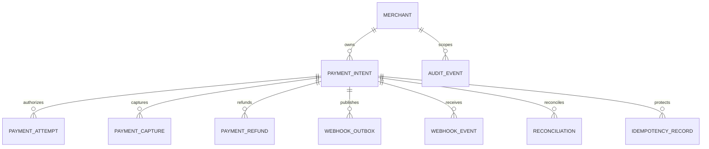

# PayBridge Backend Architecture

Maintained in this independent Git repository at **docs/architecture.md**. Updated **2026-11-09**. The guide covers the implemented stack, interfaces, data model, operational limits, and release requirements.

## Contents

1. [Scope, users, and repository boundary](#1-scope-users-and-repository-boundary)
2. [Context, containers, and trust boundaries](#2-context-containers-and-trust-boundaries)
3. [Source ownership and module map](#3-source-ownership-and-module-map)
4. [Screens, navigation, and lifecycle](#4-screens-navigation-and-lifecycle)
5. [Primary workflows and recovery](#5-primary-workflows-and-recovery)
6. [Domain, persistence, and data ownership](#6-domain-persistence-and-data-ownership)
7. [API and internal contracts](#7-api-and-internal-contracts)
8. [Security, privacy, and egress](#8-security-privacy-and-egress)
9. [Design, accessibility, and platform adapters](#9-design-accessibility-and-platform-adapters)
10. [Build, checks, and deployment](#10-build-checks-and-deployment)
11. [Architecture decisions and tradeoffs](#11-architecture-decisions-and-tradeoffs)
12. [Requirements traceability](#12-requirements-traceability)
13. [Dated verification and limitations](#13-dated-verification-and-limitations)
14. [Extension rules and companion repository](#14-extension-rules-and-companion-repository)

## 1. Scope, users, and repository boundary

A payment lifecycle simulator for synthetic merchants, operators, and auditors.

Simulated authorization/capture/refund flows, payment lookup, webhook delivery/retry, and reconciliation.

This repository owns the Spring Boot / Java 17 API and H2 state. UI rendering belongs to the separate frontend. The service validates and executes the domain operations described below.

There are two independent Git roots for this application, each with its own README and architecture guide. A parent app/workspace folder is a checkout convenience. Use synthetic records; current local services remain on loopback.

### Boundaries

The payment simulator is an in-process adapter. There is no external processor, live payment, analytics collector, or card-data store in this prototype.

The build-time `VITE_IS_MOCK` switch defaults to `true` and selects the API origin only. Local
mock mode uses the same-origin Vite proxy; a deployed mock build requires an explicit
`VITE_MOCK_API_BASE_URL`. Live mode requires `VITE_REAL_API_BASE_URL`; neither mode falls back
to the other. Both modes load allowed profiles from `/api/v1/auth/profiles` and establish
server-managed sessions through `/api/v1/auth/profile-login`. The content model supplies
presentation labels only. The mode never creates identity, account/payment state, or idempotency
values in the browser; payment and tender flows remain sandbox-only.

## 2. Context, containers, and trust boundaries

The API is the data authority, but only the identity/ownership controls actually implemented below can be relied on. CORS is not authentication.

### Containers

- **Frontend:** React 19, TypeScript, Vite, Zod response validation, cookie-based API calls. `VITE_IS_MOCK` defaults to true at build time. Both modes fetch profile choices from the selected API and use server-managed sessions and API-owned payment data. Local mock development uses Vite's `/api` and `/actuator` proxy to port 5602 unless a mock API origin is explicitly configured.
- **API:** Spring Boot controllers, validation, exact-origin credentialed CORS, Spring Security session/CSRF, application service, payment simulator, webhook signer/receiver, JDBC repository, Flyway migrations, structured logging, and health endpoint.
- **Database:** file-backed H2 for local development and tests; PostgreSQL profile for a separately provisioned database.

## 3. Source ownership and module map

| Owner/path                                                                                                                                                                                                                                                                                                                                                                                                                    | Responsibility                                                               |
| ----------------------------------------------------------------------------------------------------------------------------------------------------------------------------------------------------------------------------------------------------------------------------------------------------------------------------------------------------------------------------------------------------------------------------- | ---------------------------------------------------------------------------- |
| [src/main/java/com/paybridge/PayBridgeApplication.java](../src/main/java/com/paybridge/PayBridgeApplication.java)                                                                                                                                                                                                                                                                                                             | Spring Boot process entry                                                    |
| [src/main/java/com/paybridge/api/AuthController.java](../src/main/java/com/paybridge/api/AuthController.java) [src/main/java/com/paybridge/api/ClientTelemetryController.java](../src/main/java/com/paybridge/api/ClientTelemetryController.java) [src/main/java/com/paybridge/api/OperationsController.java](../src/main/java/com/paybridge/api/OperationsController.java)                                             | HTTP adapters and public request handling                                    |
| [src/main/java/com/paybridge/service/PaymentApplicationService.java](../src/main/java/com/paybridge/service/PaymentApplicationService.java) [src/main/java/com/paybridge/service/WebhookDeliveryService.java](../src/main/java/com/paybridge/service/WebhookDeliveryService.java) [src/main/java/com/paybridge/service/WebhookReceiverService.java](../src/main/java/com/paybridge/service/WebhookReceiverService.java) | Application/domain services; verify individual transaction/permission owners |
| [src/main/java/com/paybridge/persistence/PaymentRepository.java](../src/main/java/com/paybridge/persistence/PaymentRepository.java)                                                                                                                                                                                                                                                                                           | Persistence boundary and queries                                             |
| [src/main/java/com/paybridge/config/SecurityConfig.java](../src/main/java/com/paybridge/config/SecurityConfig.java)                                                                                                                                                                                                                                                                                                           | Security/session configuration and synthetic identity                        |
| [src/main/java/com/paybridge/api/ApiExceptionHandler.java](../src/main/java/com/paybridge/api/ApiExceptionHandler.java) [src/main/java/com/paybridge/config/RequestCompletionFilter.java](../src/main/java/com/paybridge/config/RequestCompletionFilter.java)                                                                                                                                                              | Safe error handling and request logging                                      |
| [src/main/resources/db/migration/V1__core_schema.sql](../src/main/resources/db/migration/V1__core_schema.sql) [src/main/resources/db/migration/V2__synthetic_demo_data.sql](../src/main/resources/db/migration/V2__synthetic_demo_data.sql) [src/main/resources/db/migration/V3__normalize_merchant_display_names.sql](../src/main/resources/db/migration/V3__normalize_merchant_display_names.sql)                     | Ordered Flyway schema/seed migrations                                        |
| [src/main/resources/application-postgres.properties](../src/main/resources/application-postgres.properties) [src/main/resources/application-test.properties](../src/main/resources/application-test.properties)                                                                                                                                                                                                            | Local/postgres profile configuration                                         |
| [pom.xml](../pom.xml)                                                                                                                                                                                                                                                                                                                                                                                                         | Java/dependency/build/quality gate authority                                 |
| [docs/openapi.yaml](../docs/openapi.yaml)                                                                                                                                                                                                                                                                                                                                                                                     | Published request/response contract source                                   |
| [src/test](../src/test)                                                                                                                                                                                                                                                                                                                                                                                                       | Existing test/support directory; configured does not mean rerun              |
| [.github/workflows](../.github/workflows)                                                                                                                                                                                                                                                                                                                                                                                     | Configured CI; hosted outcomes require separate verification                 |

The source map follows the existing framework directories and test placement.

## 4. Screens, navigation, and lifecycle

This repository has no rendered screens. It supports the frontend through the HTTP/domain contracts in sections 5–7. Its lifecycle entry, response/error mapping, session behavior where present, and storage ownership are listed in section 3. Startup health is http://127.0.0.1:5602/actuator/health; that configured address is not evidence of a running service. Persistent state is owned by this backend; preserve existing database files during changes.

## 5. Primary workflows and recovery

### User scenarios

#### Merchant completes an approved payment

**Actor and precondition:** A merchant is signed into a local workspace profile and owns the target merchant account. The selected processor outcome is synthetic.

1. The merchant creates an intent with an amount in minor units, currency, description, and idempotency key.
2. The API validates the request, checks merchant ownership, and persists the intent and audit event.
3. The merchant requests authorization. The processor adapter returns its configured synthetic outcome; approval moves the intent to `AUTHORIZED`, while a decline moves it to `DECLINED`.
4. An authorized intent can be captured. The API updates captured amounts and writes a webhook outbox event in the same transaction.
5. The merchant delivers the pending event. The in-process adapter signs the exact payload, and the receiver verifies and deduplicates it.
6. An operator reconciles expected captures/refunds against received signed events. A matching ledger produces `MATCHED`; missing events produce `PENDING`, and differences produce `MISMATCH`.

The flow is idempotent for state-changing commands. A retry with the same key and payload returns the prior result; reuse with a different payload is rejected. No processor network call or transfer of funds occurs.

#### Merchant handles a declined authorization

**Actor and precondition:** A merchant creates an intent with the decline outcome selected in the processor simulator.

The API records a declined attempt and leaves the intent in `DECLINED`. Capture is rejected as an invalid state transition. The merchant can inspect the failure reason/state and create a new intent for a later attempt; this workflow does not claim that a real issuer or processor declined a payment.

#### Operator reviews an authorization and refund

**Actor and precondition:** An operator is signed in and the intent is within the operator's allowed portfolio scope.

The operator can void an authorized intent or record a refund up to the captured, unrefunded amount. Each command requires an idempotency key, is checked against the state machine, and creates an audit record. Refunds update the internal ledger only; no external funds are moved.

#### Auditor inspects payment history

**Actor and precondition:** An auditor is signed in with read-only permissions.

The auditor can search intents and inspect intent details, webhook verification, reconciliation results, and audit history. Create, authorize, capture, void, refund, delivery, and reconciliation mutations are denied server-side.

### Critical sequence

## 6. Domain, persistence, and data ownership

The API owns the current persistence boundary. Keep database engines, schema/migration order, exact-money rules where applicable, and transaction invariants consistent with executable source.

### Data model

Money is represented as integer minor units with USD enforced by validation and database constraints. Payment intent transitions and captured/refunded amount invariants are enforced by the application service and database constraints.

## 7. API and internal contracts

The repository contract is [docs/openapi.yaml](../docs/openapi.yaml). Keep public paths, status/error envelopes, headers, payload validation, and compatibility tied to that source.

Requests must use the implemented routes and validation; The API and event contracts are unchanged.

## 8. Security, privacy, and egress

Current release limitation: **No processor is contacted and no funds move. The additional responsive check fails with horizontal overflow; formatting, durable webhook secrets, identity, and hosting still need work.**

Only the local simulator controls in the current source are implemented. CORS, a role label, and mode selection do not provide a new production identity boundary.

Keep private credentials out of public models, browser bundles, logs, URLs, and source archives. No additional runtime network destination or external service is configured. Keep logs limited to the source-defined request/trace and safe aggregate fields. Backups, retention, deletion, and real-user ownership need explicit product/operations decisions before external exposure.

## 9. Design, accessibility, and platform adapters

There is no visual rendering or native package in this API repository. Preserve safe errors and stable contracts so the frontend can present accessible recovery states. Hardware scanning, banking/payment rails, shipping providers, and native integrations remain limited to what the current source actually implements; simulator behavior is not device/provider integration.

## 10. Build, checks, and deployment

Use Java **17** and Maven **3.9.16** with [pom.xml](../pom.xml). `mvn.cmd -B -ntp -Dspring.profiles.active=test verify` uses the configured isolated test profile. Run local startup through the existing README command; inherited DEBUG must be removed only in newly launched Java processes. Java verification was not rerun for the documentation updates. Maven dependency installation needs registry access.

The API remains loopback-only. Direct-start storage is `.local/paybridge` relative to this repository.

CI configuration is listed in section 3. Run the configured checks before merging or releasing. Deployment requires separate verification of the selected hosting environment.

## 11. Architecture decisions and tradeoffs

### Implemented Design Patterns and Invariants

- **Layered modular monolith:** versioned Spring controllers validate requests; application/domain services own payment transitions; repositories persist within explicit transaction boundaries.
- **Ports/adapters for simulated processing:** authorization delegates to a deterministic local simulator. No PAN/CVV, external processor credentials, live payment call, or real funds are part of the adapter.
- **State machine and money invariants:** only permitted transitions are accepted; captured/refunded totals remain bounded; all money uses integer minor units and USD.
- **Idempotent commands:** create/authorize/capture/void/refund/reconcile bind keys to request hashes. Same-payload retries return prior results; conflicting key reuse does not repeat the operation.
- **Transactional outbox and receiver dedupe:** capture/refund state and outbox records commit atomically; signed in-process delivery is verified and event IDs are deduplicated before reconciliation reads them.
- **Authorization and audit:** the API derives role/principal from the server session, scopes merchants, rejects auditor mutations, and records allowlisted audit events. The UI is not an authorization boundary.

The two Git repositories remain separate. Each owns one maintained README and this repository-local architecture guide. Shared application behavior may be described here for contract context, but implementation changes belong to the owning source module.

## 12. Requirements traceability

| Capability                       | Acceptance                                                        | Owner/path                                                  | Current status                                                | Evidence                               | Risk                                                                                                                                                                                     |
| -------------------------------- | ----------------------------------------------------------------- | ----------------------------------------------------------- | ------------------------------------------------------------- | -------------------------------------- | ---------------------------------------------------------------------------------------------------------------------------------------------------------------------------------------- |
| Repository-local architecture    | Guide available in this checkout and linked from README           | docs/architecture.md; README.md                             | Documented and validated                                      | File, link, and diagram checks         | Keep documentation consistent with source changes                                                                                                                                        |
| API composition and domain state | Preserve existing workflows and failure states                    | src/main/java/com/paybridge/api/ApiDtos.java and source map | Implemented; application verification limits are listed below | Current source and existing app design | No processor is contacted and no funds move. The additional responsive check fails with horizontal overflow; formatting, durable webhook secrets, identity, and hosting still need work. |
| Public deployment                | Verified identity, data durability, recovery, and hosted behavior | Existing deployment/API boundaries                          | Needs separate hardening/verification                         | No new hosted evidence                 | Local checks do not establish production readiness                                                                                                                                       |

## 13. Dated verification and limitations

Last documentation review: **2026-11-09**. The checks below distinguish documentation validation from application and deployment testing.

- Repository-local guide, README link, source-path references, section/contents anchors, and Mermaid syntax: passed documentation validation.
- New application tests/builds, coverage, dependency audits, browser/device accessibility/performance, hosted CI, and Vercel deployment: **not rerun for the documentation updates**.
- Frontend production builds passed on 2026-11-09 with Node 24.15.0. Build success does not establish that all application quality gates pass.
- Outstanding baseline limit: No processor is contacted and no funds move. The additional responsive check fails with horizontal overflow; formatting, durable webhook secrets, identity, and hosting still need work.

The baseline results below record earlier validation. Re-run the listed commands against the current revision before release.

Previously recorded application verification:

### Verification status

The 2026-11-01 local run passed 72 frontend tests with **95.72% statements, 92.13% branches,
91.71% functions, and 96.88% lines**, and 60 backend tests with **100% JaCoCo instructions,
99.54% branches, 100% methods, and 100% lines**. The API client, mode configuration, and money
module have frontend 95% per-file thresholds. The backend enforces 95% class-level thresholds for
payment application/state transitions, the simulator, webhook processing/signatures, profile
catalog/auth, persistence, and security.

The Playwright payment workflow passed 1/1 in each mode on isolated ports with in-memory H2. The
backend CI enforces Java line length and Maven coverage gates; frontend CI currently does not run
the cross-repository E2E workflow. Neither CI nor local tests validate production PostgreSQL,
identity, or a real processor.

## 14. Extension rules and companion repository

Start with [README.md](../README.md) and this guide. The companion repository is [paybridge-frontend](https://github.com/gopichand-retail-apps/paybridge-frontend); clone the pair as siblings when using the existing local integration/model contract. This guide is inside the current repository and does not depend on a parent-folder architecture file to exist.

Update this guide when owned source, routes, persistence, identity, UI states, egress, or deployment behavior changes. Coordinate public contract changes with the companion repository and tests. Preserve existing data, run isolated checks with synthetic records, record failures, and review release and infrastructure changes before publication.
