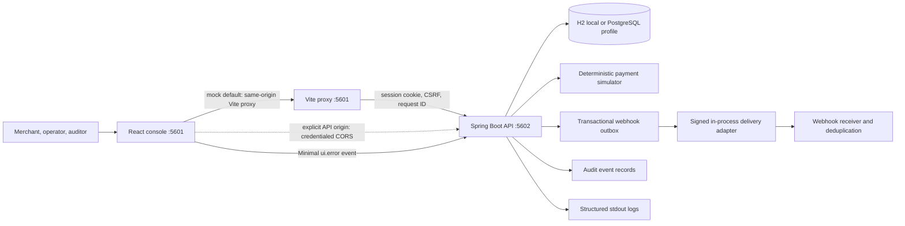
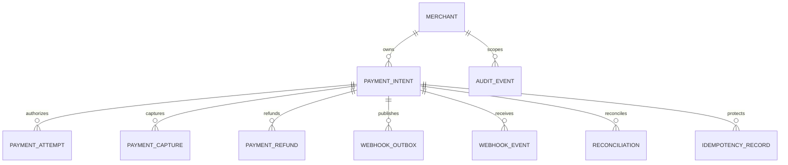
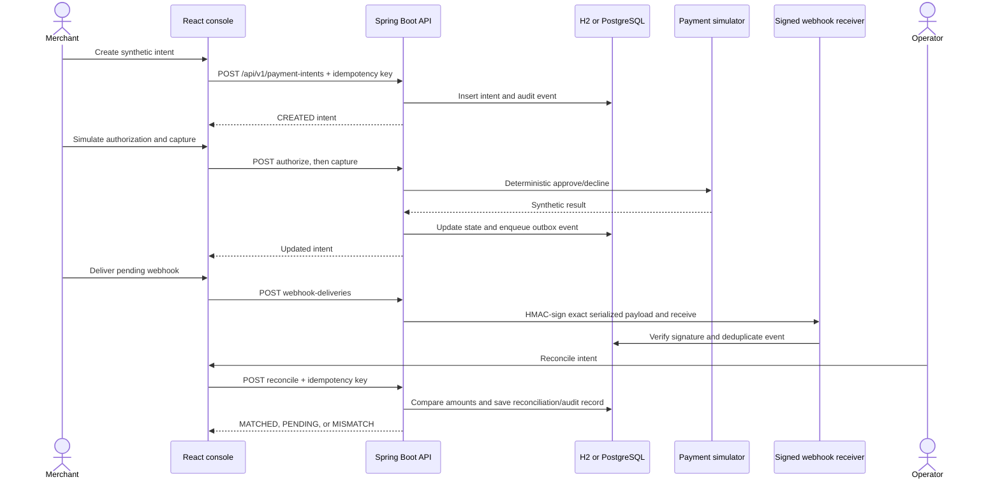

# PayBridge Architecture

The [workspace data-mode guide](../../DATA_MODE_AND_ARCHITECTURE.md) documents
the public frontend configuration and exact mock/live E2E commands.

## Boundaries

The payment simulator is an in-process adapter. There is no external processor, live payment, analytics collector, or card-data store in this prototype.

The build-time `VITE_IS_MOCK` switch defaults to `true` and selects the API origin only. Local
mock mode uses the same-origin Vite proxy; a deployed mock build requires an explicit
`VITE_MOCK_API_BASE_URL`. Live mode requires `VITE_REAL_API_BASE_URL`; neither mode falls back
to the other. Both modes load allowed profiles from `/api/v1/auth/profiles` and establish
server-managed sessions through `/api/v1/auth/profile-login`. The content model supplies
presentation labels only. The mode never creates identity, account/payment state, or idempotency
values in the browser; payment and tender flows remain sandbox-only.

## Containers

- **Frontend:** React 19, TypeScript, Vite, Zod response validation, cookie-based API calls. `VITE_IS_MOCK` defaults to true at build time. Both modes fetch profile choices from the selected API and use server-managed sessions and API-owned payment data. Local mock development uses Vite's `/api` and `/actuator` proxy to port 5602 unless a mock API origin is explicitly configured.
- **API:** Spring Boot controllers, validation, exact-origin credentialed CORS, Spring Security session/CSRF, application service, payment simulator, webhook signer/receiver, JDBC repository, Flyway migrations, structured logging, and health endpoint.
- **Database:** file-backed H2 for local development and tests; PostgreSQL profile for a separately provisioned database.

## Data model

Money is represented as integer minor units with USD enforced by validation and database constraints. Payment intent transitions and captured/refunded amount invariants are enforced by the application service and database constraints.

## User scenarios

### Merchant completes an approved payment

**Actor and precondition:** A merchant is signed into a local workspace profile and owns the target merchant account. The selected processor outcome is synthetic.

1. The merchant creates an intent with an amount in minor units, currency, description, and idempotency key.
2. The API validates the request, checks merchant ownership, and persists the intent and audit event.
3. The merchant requests authorization. The processor adapter returns its configured synthetic outcome; approval moves the intent to `AUTHORIZED`, while a decline moves it to `DECLINED`.
4. An authorized intent can be captured. The API updates captured amounts and writes a webhook outbox event in the same transaction.
5. The merchant delivers the pending event. The in-process adapter signs the exact payload, and the receiver verifies and deduplicates it.
6. An operator reconciles expected captures/refunds against received signed events. A matching ledger produces `MATCHED`; missing events produce `PENDING`, and differences produce `MISMATCH`.

The flow is idempotent for state-changing commands. A retry with the same key and payload returns the prior result; reuse with a different payload is rejected. No processor network call or transfer of funds occurs.

### Merchant handles a declined authorization

**Actor and precondition:** A merchant creates an intent with the decline outcome selected in the processor simulator.

The API records a declined attempt and leaves the intent in `DECLINED`. Capture is rejected as an invalid state transition. The merchant can inspect the failure reason/state and create a new intent for a later attempt; this workflow does not claim that a real issuer or processor declined a payment.

### Operator reviews an authorization and refund

**Actor and precondition:** An operator is signed in and the intent is within the operator's allowed portfolio scope.

The operator can void an authorized intent or record a refund up to the captured, unrefunded amount. Each command requires an idempotency key, is checked against the state machine, and creates an audit record. Refunds update the internal ledger only; no external funds are moved.

### Auditor inspects payment history

**Actor and precondition:** An auditor is signed in with read-only permissions.

The auditor can search intents and inspect intent details, webhook verification, reconciliation results, and audit history. Create, authorize, capture, void, refund, delivery, and reconciliation mutations are denied server-side.

## Integration boundaries

CommerceHub and RetailFlow integrate through backend-to-backend REST adapters using idempotency keys and request correlation. They retain ownership of their orders and customer data; PayBridge owns payment state. No shared database access is supported. Local profile sign-in is not service-to-service authentication. Federated service identity, externally hosted webhook delivery, and a live payment-provider adapter require separate implementation and security review.

## Critical sequence

## Implemented Design Patterns and Invariants

- **Layered modular monolith:** versioned Spring controllers validate requests; application/domain services own payment transitions; repositories persist within explicit transaction boundaries.
- **Ports/adapters for simulated processing:** authorization delegates to a deterministic local simulator. No PAN/CVV, external processor credentials, live payment call, or real funds are part of the adapter.
- **State machine and money invariants:** only permitted transitions are accepted; captured/refunded totals remain bounded; all money uses integer minor units and USD.
- **Idempotent commands:** create/authorize/capture/void/refund/reconcile bind keys to request hashes. Same-payload retries return prior results; conflicting key reuse does not repeat the operation.
- **Transactional outbox and receiver dedupe:** capture/refund state and outbox records commit atomically; signed in-process delivery is verified and event IDs are deduplicated before reconciliation reads them.
- **Authorization and audit:** the API derives role/principal from the server session, scopes merchants, rejects auditor mutations, and records allowlisted audit events. The UI is not an authorization boundary.

## Local repository layout

`../paybridge-frontend` and this `paybridge-backend` directory each have their own `.git`. `../PayBridge.code-workspace` is a multi-root VS Code workspace only; it does not combine repository history.

## Mode verification and test boundary

`paybridge-frontend/playwright.config.ts` runs the browser and API on isolated ports 5603/5604,
selects the requested mode, and makes the unselected API and proxy unreachable. Its E2E flow
covers merchant profile login, payment-intent creation, simulated authorization/capture, signed
webhook delivery, operator login, reconciliation, and matched result. The test API uses in-memory
H2 and synthetic seeded users. It validates endpoint selection and the local API workflow; it
does not validate the PostgreSQL profile, production identity, or a real processor.

## Verification status

The 2026-11-01 local run passed 72 frontend tests with **95.72% statements, 92.13% branches,
91.71% functions, and 96.88% lines**, and 60 backend tests with **100% JaCoCo instructions,
99.54% branches, 100% methods, and 100% lines**. The API client, mode configuration, and money
module have frontend 95% per-file thresholds. The backend enforces 95% class-level thresholds for
payment application/state transitions, the simulator, webhook processing/signatures, profile
catalog/auth, persistence, and security.

The Playwright payment workflow passed 1/1 in each mode on isolated ports with in-memory H2. The
backend CI enforces Java line length and Maven coverage gates; frontend CI currently does not run
the cross-repository E2E workflow. Neither CI nor local tests validate production PostgreSQL,
identity, or a real processor.
